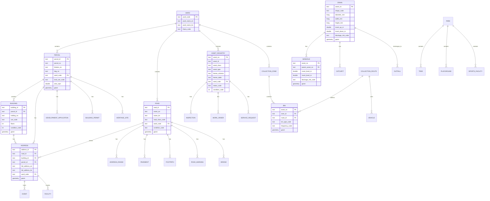

# Relational Database Design

This document explains the relational logic behind the RCC geodatabase. It is written for the article and for technical reviewers who want to see how the schema supports municipal workflows.

---

## 1. Design approach

The database is organised around five ideas:

1. **Place** — boundaries, wards, mouzas, waterbodies.
2. **Property** — parcels, buildings, addresses, holdings.
3. **Networks** — roads, water, sewer, drainage, waste routes.
4. **Assets** — the physical objects RCC owns, operates, or maintains.
5. **Operations** — inspections, work orders, service requests, condition assessments.

The schema uses:

- stable text UUIDs for primary keys;
- a separate human-readable `asset_no` for assets;
- coded-value domains for controlled fields;
- foreign keys for parent-child relationships;
- a cross-theme `asset_registry` for operational attachments;
- provenance fields on every feature.

---

## 2. Simplified entity-relationship diagram



---

## 3. Core relationships

### 3.1 Ward → parcel, road, asset

The ward is the primary administrative reporting unit. Every parcel, road, and asset carries `ward_code`. This allows:

- ward-level service dashboards;
- budget allocation by ward;
- councillor briefings;
- public “my ward” views;
- data completeness by ward.

The ward table is the origin of one-to-many relationships to parcels, roads, and the asset registry.

### 3.2 Parcel → building → address

The parcel is the legal/land unit. The building is the physical structure. The address is the human access point.

A parcel can contain many buildings. A building can contain many addresses (floors, units, shops). An address can link to a parcel, a building, or both. This is important in mixed-use and multi-storey development, which is common in Rajshahi.

### 3.3 Road → address range → address

The road centreline carries address ranges on the left and right sides. This supports:

- address interpolation;
- geocoding of Excel holding records;
- “find my road” public search;
- route planning for waste and maintenance.

The address range table stores `from_no`, `to_no`, `from_measure`, `to_measure`, and `side_code` (left/right/both).

### 3.4 Asset registry → inspection, work order, service request

The asset registry is a thin table with one row per asset across all themes. It allows operational records to attach to any asset without creating a separate relationship for every asset type.

Example:

```text
asset_registry.asset_no = RCC-DRN-000123
inspection.asset_no     = RCC-DRN-000123
work_order.asset_no     = RCC-DRN-000123
service_request.asset_no = RCC-DRN-000123
```

This is a pragmatic alternative to a full utility-network model in a file geodatabase. In PostGIS, the registry can be maintained by a trigger or a scheduled job.

### 3.5 Drain → manhole / catchpit / outfall

Drainage is a network, not a set of isolated lines. A drain has manholes, catchpits, and outfalls. The schema stores:

- `parent_asset_no` on manholes and catchpits;
- `outfall_id` on drains;
- invert levels and slope on drains and manholes.

This supports flow tracing and blockage analysis.

### 3.6 Collection zone → bin → route → vehicle

Waste collection is a many-to-many operation:

- a zone contains many bins;
- a route collects many bins;
- a vehicle serves a route.

The `route_bin` table resolves the many-to-many relationship between routes and bins. The vehicle table links fleet capacity to route demand.

### 3.7 Park → tree / playground / sports facility

Parks are polygons; trees, playgrounds, and sports facilities are child assets. This supports:

- park maintenance planning;
- tree risk assessment;
- public park search;
- climate and shade analysis.

---

## 4. Key design decisions

### 4.1 Stable IDs versus business keys

- `asset_no` is the business key used by staff and contractors.
- `asset_id` is a UUID for future database migration.
- `parcel_id`, `building_id`, `address_id`, and `road_id` are stable UUIDs.
- Business references such as `holding_no`, `khatian_no`, `dag_no`, and `parcel_no` are stored separately because they can change across survey systems.

### 4.2 Common asset block

Asset-like tables share a common block:

```text
asset_id, asset_no, asset_class, asset_type, subtype,
name_en, name_bn, status_code, owner_org_code,
custodian_org_code, operator_org_code, ward_code,
address_id, install_date, commission_date,
decommission_date, condition_code, condition_date,
criticality_code, replacement_value_bdt,
expected_life_yrs, maintenance_code,
source_code, source_date, accuracy_m,
capture_method_code, qa_status_code,
created_at, created_by, updated_at, updated_by, notes
```

This repetition is intentional. It allows staff to move between layers without relearning the schema, and it allows new asset types to be appended without redesign.

### 4.3 Provenance

Every feature carries:

- `source_code` — survey, orthophoto, CAD, paper map, field sketch, third party;
- `source_date`;
- `accuracy_m`;
- `capture_method_code`;
- `qa_status_code`.

This is how RCC can distinguish survey-grade data from digitised paper maps and avoid presenting everything as equally reliable.

### 4.4 Address gazetteer

The address gazetteer is a materialised view or search table combining:

- `address_point.full_address_en` and `full_address_bn`;
- `road_centerline.name_en` and `name_bn`;
- `ward_boundary.ward_name_en` and `ward_name_bn`;
- `mahalla_boundary.mahalla_name_en` and `mahalla_name_bn`;
- facility and park names.

It is indexed with `pg_trgm` and/or `tsvector` for fuzzy search. In a file geodatabase, the same idea can be implemented as a search table or a QGIS locator filter.

### 4.5 History

The file geodatabase uses editor tracking and a `meta_load_log` table. In PostGIS, add:

- `valid_from`, `valid_to`, `is_current` on slowly changing attributes;
- an `audit` schema with triggers;
- a history table per asset theme, or a single JSONB history table.

---

## 5. Normalisation and pragmatism

The schema is normalised enough to avoid duplication, but not so normalised that it becomes unusable in QGIS or ArcGIS Pro.

- Geometry is stored once per feature.
- Relationships are expressed through foreign keys, not duplicated geometry.
- Domains enforce controlled values.
- Subtypes are used only where they simplify the model (public facilities).
- The asset registry avoids a proliferation of relationship classes.

The goal is a database that a small GIS team can maintain, not a theoretical model that requires a database administrator for every change.

---

## 6. From file geodatabase to PostGIS

The file geodatabase is the starting point. The PostGIS migration should preserve:

- table names and field names;
- `asset_no` and UUIDs;
- domains as lookup tables or check constraints;
- relationship classes as foreign keys;
- editor tracking as audit triggers;
- `meta_layer` as the layer catalogue.

The migration should not rename fields or change identifiers. That is why the schema uses portable names and explicit types from the beginning.

---

## 7. What the article should show

For the article, include:

1. A simplified ERD with 12–15 entities (Figure 7).
2. A table of cardinalities for the core relationships.
3. A short explanation of the asset registry.
4. A short explanation of the address gazetteer.
5. A note on provenance and accuracy tiers.

Do not include all 65 feature classes in the ERD. The article needs to show the logic, not the entire schema.
