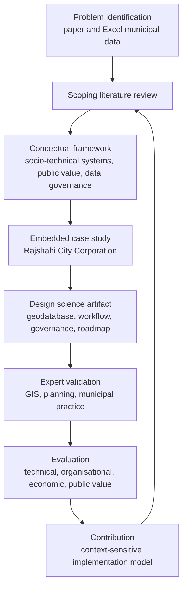
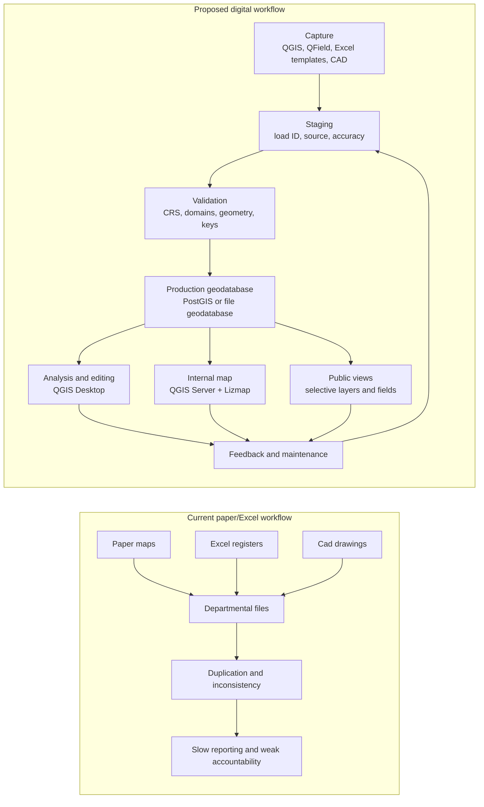
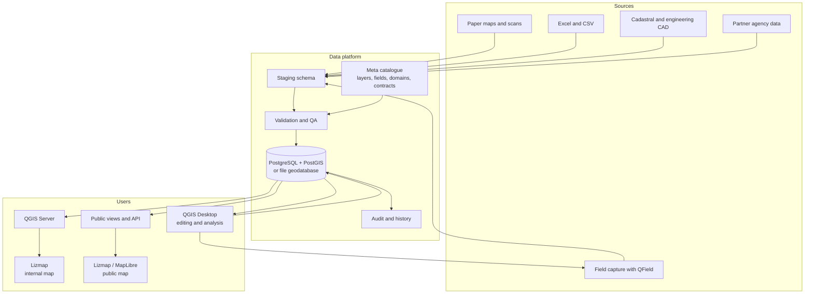
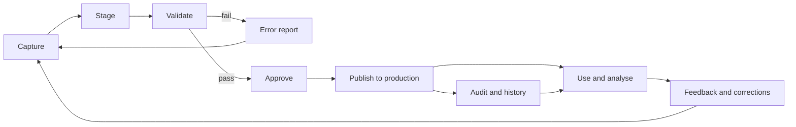
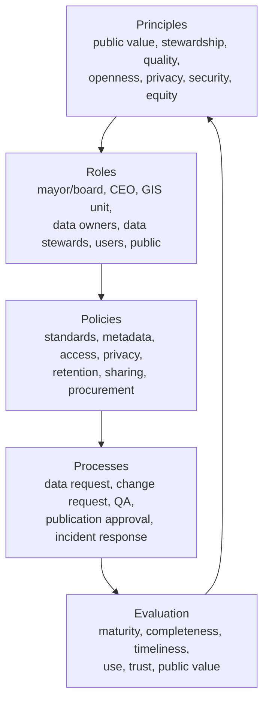
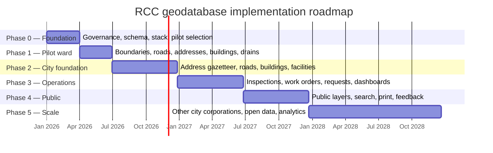
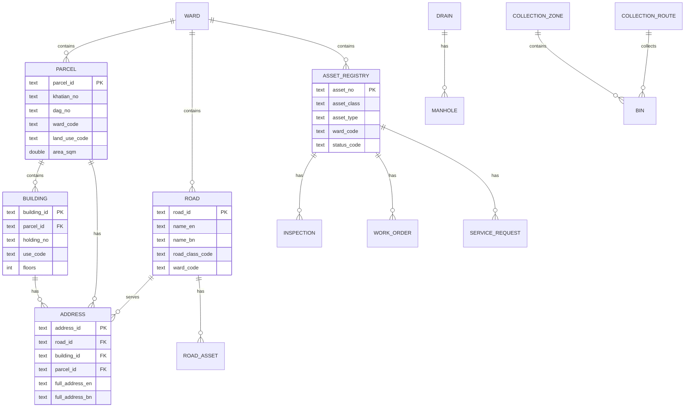
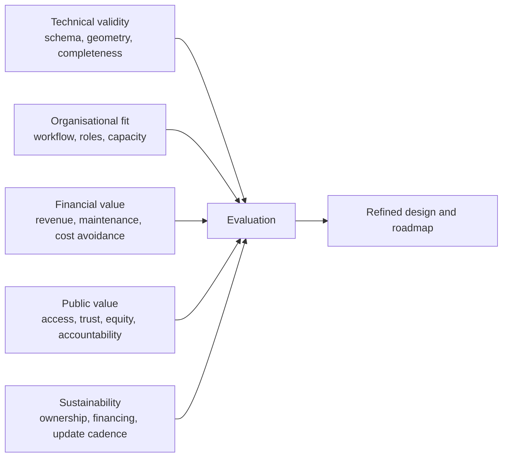

# Figure Specifications and Draft Mermaid Diagrams

These diagrams are working figures. Redraw them in a journal-compatible tool (draw.io, Inkscape, Adobe Illustrator, or QGIS layout) before submission. Keep the source text in this file so the figures remain reproducible.

---

## Figure 1 — Research design

**Caption:** Research design combining a scoping review, an embedded case study, and design science research.

---

## Figure 2 — Current and proposed workflows

**Caption:** The shift from distributed paper records to a staged, validated, and maintained municipal data workflow.

---

## Figure 3 — System architecture

**Caption:** A socio-technical architecture in which the geodatabase, metadata, and validation layer are more durable than any single front-end.

---

## Figure 4 — Data lifecycle and automation

**Caption:** The data lifecycle. Automation is concentrated in staging, validation, publication, and audit, not in replacing professional judgement.

---

## Figure 5 — Data governance framework

**Caption:** A five-layer governance framework for RCC’s spatial data system.

---

## Figure 6 — Implementation roadmap

**Caption:** A phased roadmap. The dates are illustrative and should be adjusted to RCC’s budget and procurement cycle.

---

## Figure 7 — Simplified relational database ERD

**Caption:** Simplified entity-relationship model. The full schema contains 65 feature classes and 9 tables; the article shows only the core relationships.

---

## Figure 8 — Evaluation framework

**Caption:** Multi-dimensional evaluation framework for the proposed system.

---

## Table specifications

### Table 1 — Literature matrix
Use `LITERATURE_MATRIX.csv`. In the article, reduce to 12–15 rows of the most important sources and put the full matrix in supplementary material.

### Table 2 — Benefits, complexities, and solutions
Summarise the literature review in three columns:
- Benefit;
- Complexity;
- Response.

### Table 3 — Layer catalogue
Use the dataset table from the geodatabase README. Include 13 datasets and representative layers, not all 65 feature classes.

### Table 4 — Data dictionary excerpt
Use `DATA_DICTIONARY_EXCERPT.md`. Show 5–6 entities, not the full 1,788-row dictionary.

### Table 5 — RACI matrix
Use the matrix in `GOVERNANCE_FRAMEWORK.md`.

### Table 6 — Risks and mitigations
Use the risk table in `IMPLEMENTATION_ROADMAP.md`.

### Table 7 — Implementation phases and KPIs
Use the phase table in `IMPLEMENTATION_ROADMAP.md`.

### Table 8 — Evaluation criteria
Use the evaluation section in `ARTICLE_PLAN.md`.
